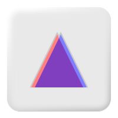

# <br>Nib

**Nib** is a programming language being designed by a human and an AI
together. It aims to replace PHP on the server, compile to WebAssembly for the browser, and
be as easy for coding agents to read and write as it is for people: clear over clever,
magic only where it pays for itself, and APIs that read like English.

```nib
import std.app.{App, Env}
import std.http.{Request, Response}

pub fn main(env: Env) -> App {
	return App(http: hello)
}

fn hello(req: Request) -> Response {
	let name = req.query.get("name") ?? "world"
	return Response.html(html"<h1>Hello, ${name}!</h1>")
}
```

**Status: design.** There is no compiler, so nothing runs yet. There is a checker that
parses and type-checks every example, the standard library's declarations and the guide's
code, plus editor support: syntax highlighting and a language server.

## Start here

If someone has shared this with you for your opinion, thank you. Here's a route through it.
None of it needs installing: it's all reading.

1. **Read [`examples/hello/`](examples/hello/)**: two files, a couple of minutes.
2. **Read [`examples/notes/src/main.nibl`](examples/notes/src/main.nibl) cold, before the
   guide.** It's a small web app, with one table, one form and one guard.
   Its `nib.toml` and `schema.sql` say which database it uses.
   Make a note of what you guess as you go, and where you're unsure. This is the most useful
   thing you can give: once you've read the guide, you can't read the code cold again.

   If you'd like a second cold read, closer to your own work, pick one of these:
   - [`examples/convert/convert.nibl`](examples/convert/convert.nibl): a command-line
     CSV and JSON converter. It streams its input, which the guide covers late, in
     chapter 14;
   - the shop's account rules, such as signing up and resetting a password. Read the
     files in `examples/shop/src/users/` in this order:
     1. [`user.nibl`](examples/shop/src/users/user.nibl), the `User`, `Email` and
        `Password` types;
     2. [`repository.nibl`](examples/shop/src/users/repository.nibl) and
        [`work.nibl`](examples/shop/src/users/work.nibl), what the rules need from
        storage;
     3. [`accounts.nibl`](examples/shop/src/users/accounts.nibl), the rules themselves;
     4. [`accounts.test.nibl`](examples/shop/src/users/accounts.test.nibl), their tests.

   The shop's web pages, such as [`web/auth.nibl`](examples/shop/src/web/auth.nibl), are
   better read after the guide: they draw on a route table, guards, forms and a container
   spread across several files. [The shop's README](examples/shop/README.md) gives an
   order for reading them.
3. **Read [the guide](guide/README.md).** Start with [A first look](guide/00-first-look.md),
   which reads the notes app again, from top to bottom, and links each part to its chapter.
   If you know PHP, [the table that maps PHP to Nib](guide/README.md#coming-from-php) helps
   too. Chapters 1 to 8 are the core of the language, about two hours of reading. The
   examples are web apps, so chapters 9 (the web) and 10 (databases) come next: the web
   chapter's ["The order of work on a request"](guide/09-web.md#the-order-of-work-on-a-request)
   says what happens before a handler runs, such as the CSRF check. Chapter 11 covers the
   secrets the shop uses. The rest can wait until you need them.
4. **Then go back to your example**, or wander through [`examples/shop/`](examples/shop/),
   the largest one. [Its README](examples/shop/README.md) suggests an order for the whole
   shop.

If you wonder why something is the way it is, look it up in
[`design/decisions.md`](design/decisions.md), one line per decision, grouped like the guide.
Each line's number leads to the full entry in
[`design/decisions-log.md`](design/decisions-log.md), with the reasons and what was turned
down.

### Questions for you

Answer any of these, in any order. Rough notes are fine. Quote a file and line where you
can. [The principles](design/principles.md) are what each decision is judged against, so
they're the yardstick for question 8.

1. In the example you read cold, what did you guess, and where did you guess wrong?
2. Where did something happen that you couldn't see the cause of?
3. Errors are values: `-> Note else WebError`, with `try` to pass a failure on. Would you
   miss exceptions?
4. `else` appears after `if` and in signatures (`-> Note else WebError`), and `catch`
   after a call, to handle its failure. Did each read naturally?
5. What would you reach for on your first day that isn't there?
6. Where did the code read like English, and where didn't it?
7. If an agent had written this code, could you review it with confidence? What would slow
   you down?
8. What would you argue against? Strong opinions are welcome.

### What not to worry about

- Nothing runs. There's a checker, but no compiler.
- The standard library exists only as declarations: signatures with docs.
- Performance hasn't been measured, because there's nothing to measure yet.
- Some things a web developer reaches for aren't designed yet, such as file uploads and
  regular expressions. If you miss one, say so.

Send your notes to Anthony, however suits you.

## Where things are

| Directory | What's in it |
|---|---|
| [`guide/`](guide/) | The language guide: what the language is and how to use it, a chapter per topic, with checked examples. |
| [`examples/`](examples/) | Code to read. Start with `hello/`, then the demo app in `shop/`: sign-up, sign-in, password reset, encrypted personal data, checkout, migrations and tests. |
| [`design/principles.md`](design/principles.md) | The seven principles every decision is judged against, each with an example. |
| [`design/decisions.md`](design/decisions.md) | What's decided, one line per decision, grouped like the guide: the quickest answer to "why is it like this?". |
| [`design/decisions-log.md`](design/decisions-log.md) | Every decision in full, numbered, with the reasons, the ideas turned down, and what later changed it. |
| [`design/grammar.md`](design/grammar.md) | The grammar the checker implements. |
| [`design/keywords.md`](design/keywords.md) | Reserved words and where each comes from. |
| [`design/references.md`](design/references.md) | The languages and libraries each feature was borrowed from. |
| [`design/rationale/`](design/rationale/) | Longer arguments behind a few decisions, such as why there are no exceptions. |
| [`design/brand/`](design/brand/) | The logo, as SVG (and a 512 px PNG): two triangles that overlap almost completely to make an A. |
| [`std/`](std/) | The standard library's API, as declaration files (`.d.nibl`): signatures and docs without bodies. |
| [`packages/`](packages/) | First-party packages, such as `nib/access` (who may do what), declared like the stdlib. The shop's manifest names it `access`, so its code imports `access.{…}`. There's no registry yet, so a dependency on one of these is read from here. |
| [`tools/nib/`](tools/nib/) | The checker and the language server, in TypeScript with no dependencies. |
| [`tools/editors/textmate/`](tools/editors/textmate/) | The syntax-highlighting grammar. |
| [`AGENTS.md`](AGENTS.md) | Instructions for coding agents working in this repo (`CLAUDE.md` points to it). |

## Checking code

You need Node 24 or later; nothing to install.

```sh
node tools/nib/src/cli.ts check packages examples std guide   # must report 0 errors, 0 warnings
node tools/nib/test/run.ts                                     # the checker's own tests
node tools/nib/test/names.ts                                   # go-to-definition in the editor
```

Passing means the code parses, its names resolve and its types check. Agreed rules the
checker can't enforce yet are listed in `tools/nib/PENDING-CHECKS.md`.

## Editor support

### Syntax highlighting

The grammar in `tools/editors/textmate` works in JetBrains IDEs and VS Code-based editors.

**IntelliJ IDEA, PhpStorm, WebStorm and other JetBrains IDEs**

1. Settings → Plugins: check that **TextMate Bundles** is enabled (it comes with the IDE).
2. Settings → Editor → TextMate Bundles → **+**, and choose the `tools/editors/textmate`
   folder in this repo.
3. If `.nibl` files still open as plain text, remove `*.nibl` from Settings → Editor →
   File Types → Text.

**VS Code, Cursor, Windsurf, VSCodium**

Link the folder into the editor's extensions directory, then reload the window:

```sh
ln -s "$PWD/tools/editors/textmate" ~/.vscode/extensions/nib    # VS Code
ln -s "$PWD/tools/editors/textmate" ~/.cursor/extensions/nib    # Cursor
```

Windsurf uses `~/.windsurf/extensions` and VSCodium `~/.vscode-oss/extensions`.

### Language server

`tools/nib/src/lsp.ts` reports the checker's errors as you type, folds comments and
blocks, and fills the outline.

**JetBrains IDEs**

1. Install the **LSP4IJ** plugin (free, by Red Hat) from Settings → Plugins → Marketplace.
2. Settings → Languages & Frameworks → Language Servers → **+**:
   - Name: `nib`
   - Command: the full path to Node, then the server, such as
     `/usr/local/bin/node /path/to/this/repo/tools/nib/src/lsp.ts`. Run `which node` to
     find yours: the IDE doesn't see your shell's `PATH`, so a bare `node` may not work.
   - Mappings → File name patterns: `*.nibl`, language ID `nib`.

The server restarts itself when the checker or the stdlib's declarations change, and checks
your open files again, so its errors always follow the current rules.

**VS Code-based editors:** not yet. They start language servers through an extension, and
the one in `tools/editors/textmate` only highlights. For now, run the checker from a
terminal.

## How the design works

Each topic is argued over in rounds and recorded in `design/decisions-log.md`, with the
reasons and with the ideas that were turned down, so the same ground isn't covered twice.
`design/decisions.md` sums up what's in force, one line each. Code in
`examples/` must stand on its own: no comments that point at decision numbers or design
documents. When an example needs explaining, that's a finding about the language.
